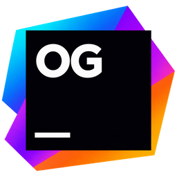

# OpenGit



[OpenGit](https://github.com/mhung59/opengit) keeps OpenIDEA's original desktop interface and concentrates it on Git management. It retains the welcome screen, project tree, editor tabs and splits, themes, keyboard shortcuts, Commit/Shelf/Stash panel, Git Log/Console/Worktrees, branch menus, diff viewer, merge editor and Local History.

AI agents, database clients and the installable plugin system have been removed. Build/run/debug, coverage/profiling, HTTP clients, deployment and remote development are not activated or exposed. The integrated Terminal (tabs, splits, shortcuts and Settings) remains available alongside Git Console. Bookmarks and the Notifications tool window, bell and menu entries are removed. Operation error messages remain visible. The editor still opens and saves files and provides syntax highlighting, folding, file search and text search; no project code scan or language server starts when a repository opens. Commit options retain Git hooks, author and sign-off, and omit code formatting, code analysis and TODO checks.

The original workbench and VCS components are used directly. There is no replacement interface. Shared backend libraries needed by these components are retained; removing a feature does not mean deleting every library that also supports the editor.

OpenGit disables the reusable host's `ide-services` feature: its host and projects do not create a debugger, run process manager or notebook service. Deployment, build execution/Maven edits and language-tool installation are also excluded from its host command dispatcher. The standalone host/server retains those APIs through its default feature. Desktop IPC adapters for run/debug, notebooks, coverage/profiling, analysis, dependency updates, Docker, GitHub, deployment, Project Trust, build execution/Maven edits, language-tool installation, SDK library/tool lookup and the retired SSH session chooser have been removed; TypeScript bindings are generated from the remaining adapters. The read-only build model remains for existing folder decorations.

OpenGit opens repositories directly, without the IDE Project Trust dialog, Restricted Mode banner or trust settings. Saved IDE trust decisions do not restrict Git operations. The standalone host retains trust checks through the `project-trust` feature enabled by `ide-services`. Commit Options keeps Run Git hooks enabled by default; turning it off skips pre-commit and commit-msg hooks for that commit (`--no-verify`). Git errors and hook failure output remain visible. Git ownership checks and `safe.directory` are not bypassed.

Git Log is split into branch, filter, commit-list and commit-detail modules. Workbench registries for settings, file editors, file decorations and project roots have separate implementations behind the existing contributions API. Only Commit, Git Log and Diff opt into idle preloading, after a project opens; other lazy views load on demand.

## Run

Requires Node.js, pnpm, Rust 1.96+, Git and the Tauri 2 native build prerequisites. On Windows install MSVC Build Tools and WebView2.

```sh
pnpm install
pnpm dev:app
```

If pnpm is not installed globally, use `npx pnpm install` and `npx pnpm dev:app`.

`pnpm dev` previews the original workbench with sample data in a browser. Real repositories and Git operations use the desktop app.

## Validation

```sh
pnpm build
pnpm test
pnpm lint
pnpm check:unused
pnpm exec playwright test e2e/gitEdition.spec.ts e2e/diff.spec.ts
cargo check -p opengit --locked
cargo test -p ide-host --no-default-features --test git_edition --test vcs_roots --test vcs_encoding --locked
```

Set `OPENIDEA_E2E_CHANNEL=msedge` to use installed Edge for browser tests; otherwise install Playwright Chromium.

`check:unused` runs the full Knip analysis, including unused exports and types as well as files and dependencies. The bindings integration test checks that the desktop exposes the Git, document and terminal commands and does not restore the retired IDE adapters. This does not imply that all shared IDE source has been deleted: retained editor code, settings models, tests and standalone-host features still share libraries.

## Upstream and license

Derived from [l0ng-ai/openidea](https://github.com/l0ng-ai/openidea). Apache-2.0; attribution is retained in LICENSE, NOTICE and THIRD_PARTY_LICENSES.md. Not affiliated with JetBrains. IntelliJ IDEA is a JetBrains trademark.

## Windows installer

The app logo master is `assets/branding/opengit-logo-v2.png`. Run `pnpm gen:icons` to regenerate the desktop icons, favicon and shared UI logo after updating it.

```sh
pnpm build:windows
```

The production NSIS installer is generated under `target/release/bundle/nsis/`. The app uses the `io.github.mhung59.opengit` identifier and installs for the current Windows user, separately from upstream OpenIDEA. Git must be installed and available on PATH.
